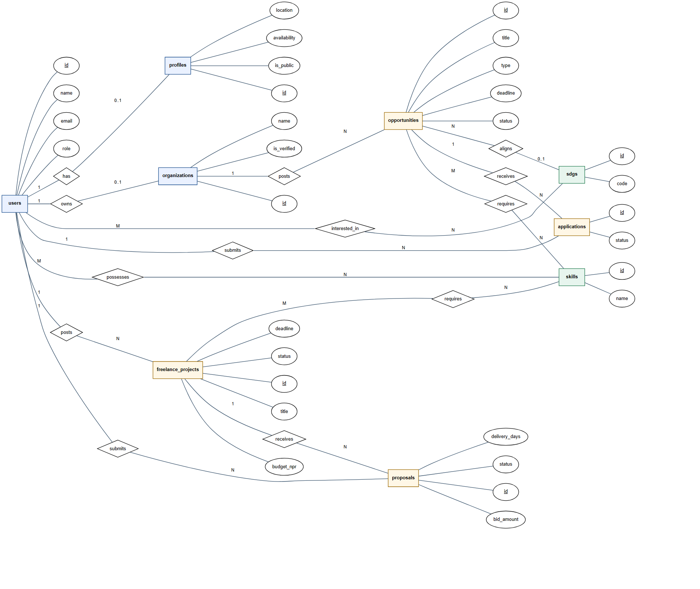

# Database Design and ER Diagrams

| Item | Value |
|---|---|
| Document version | 1.0 |
| Date | 2026-10-29 |
| Target DBMS | MySQL 8.0+ / MariaDB 10.6+ |
| Storage engine | InnoDB |
| Character set | `utf8mb4` / `utf8mb4_unicode_ci` |
| Authoritative schema | `database/schema.sql` (created in Stage 3) |
| Sample data | `database/seed.sql` (created in Stage 3) |

---

## 1. Design principles

1. **Third normal form (3NF).** Each fact is stored once. Skills, SDGs, and categories are lookup tables linked through junction tables rather than comma-separated text.
2. **Separate public and private data.** `users` holds credentials and email; `profiles` holds talent data. Public pages never select the private columns.
3. **Database-enforced integrity.** Duplicate applications and proposals are blocked by `UNIQUE` constraints, not only by API checks.
4. **Constrained vocabulary.** Roles, statuses, availability, and types use `ENUM` (or whitelisted strings) so invalid states cannot be stored accidentally.
5. **History preservation.** Organizations are protected from accidental deletion by `ON DELETE RESTRICT`; content owned by deleted users is handled by explicit, documented rules.
6. **One organization per organization-side account.** Enforced by `organizations.owner_user_id UNIQUE`. Multi-member organizations are a documented future enhancement.
7. **UTC timestamps.** `created_at` and `updated_at` use `TIMESTAMP`; display converts to `Asia/Kathmandu`.
8. **No money movement.** Budgets and bids are informational `DECIMAL` values; no payment or ledger tables exist.

### 1.1 Naming conventions

- Table names: lowercase plural (`opportunities`, `proposals`).
- Column names: lowercase snake_case (`created_by_user_id`).
- Primary key: `id` unless the table is a pure junction table.
- Foreign key: `<singular>_id` (`organization_id`, `skill_id`).
- Junction tables: both foreign keys, composite primary key, optional relationship attributes.
- Junction tables are named after what they connect (`opportunity_skills`, `user_sdgs`).

---

## 2. Table catalogue

The catalogue lists 23 tables: the 20 requested in the brief, `skill_categories` and `talent_project_skills` (both additions are explained in section 7), and `email_outbox`, an infrastructure table for outbound email.

All tables include the following unless noted:

- `created_at TIMESTAMP NOT NULL DEFAULT CURRENT_TIMESTAMP`
- `updated_at TIMESTAMP NOT NULL DEFAULT CURRENT_TIMESTAMP ON UPDATE CURRENT_TIMESTAMP`
- InnoDB engine, `utf8mb4_unicode_ci` collation

### 2.1 Identity and profiles

#### `users`

**Purpose:** one row per login account. Holds credentials and the authoritative role. Never stores talent profile content.

| Column | Type | Constraints / notes |
|---|---|---|
| `id` | INT UNSIGNED | PK, AUTO_INCREMENT |
| `name` | VARCHAR(120) | NOT NULL |
| `email` | VARCHAR(190) | NOT NULL, UNIQUE; stored lowercase; case-insensitive collation |
| `password_hash` | VARCHAR(255) | NOT NULL; `password_hash()` output |
| `role` | ENUM('job_seeker','freelancer','employer','organization','admin') | NOT NULL, default `job_seeker` |
| `status` | ENUM('active','suspended') | NOT NULL, default `active` |
| `created_at`, `updated_at` | TIMESTAMP | standard |

**Indexes:** `UNIQUE(email)`, `INDEX(role, status)`, `INDEX(name)`.

**Delete rule:** cascades to profiles, user_skills, user_sdgs, applications, saved_opportunities, notifications, comments, and posts. Restricted if the user owns an organization, a freelance project, or created other retained records (see section 6).

#### `profiles`

**Purpose:** public talent-pool information. One-to-one with a talent-side user.

| Column | Type | Constraints / notes |
|---|---|---|
| `id` | INT UNSIGNED | PK |
| `user_id` | INT UNSIGNED | NOT NULL, UNIQUE, FK → `users.id` ON DELETE CASCADE |
| `phone` | VARCHAR(30) | NULL; **private**, never rendered publicly |
| `location` | VARCHAR(120) | NOT NULL |
| `professional_title` | VARCHAR(150) | NOT NULL |
| `bio` | TEXT | NOT NULL |
| `education` | TEXT | NULL |
| `experience` | TEXT | NULL |
| `availability` | ENUM('2-5','5-10','10-20','20+') | NOT NULL; hours per week |
| `portfolio_url` | VARCHAR(255) | NULL |
| `linkedin_url` | VARCHAR(255) | NULL |
| `is_public` | TINYINT(1) | NOT NULL, default 1 |
| `created_at`, `updated_at` | TIMESTAMP | standard |

**Indexes:** `UNIQUE(user_id)`, `INDEX(location)`, `INDEX(availability)`, `INDEX(is_public)`.

**Why separate from `users`:** the user row contains the email and password hash. Keeping talent content in a separate, explicitly selected table makes it hard to leak private columns into public pages by accident.

#### `organizations`

**Purpose:** organization profile and ownership link. Created for employer/organization accounts; one owner account per organization in v1.

| Column | Type | Constraints / notes |
|---|---|---|
| `id` | INT UNSIGNED | PK |
| `owner_user_id` | INT UNSIGNED | NOT NULL, UNIQUE, FK → `users.id` ON DELETE RESTRICT |
| `name` | VARCHAR(160) | NOT NULL |
| `slug` | VARCHAR(180) | NOT NULL, UNIQUE |
| `description` | TEXT | NULL |
| `website` | VARCHAR(255) | NULL |
| `location` | VARCHAR(120) | NULL |
| `contact_email` | VARCHAR(190) | NULL |
| `is_verified` | TINYINT(1) | NOT NULL, default 0; admin-controlled |
| `created_at`, `updated_at` | TIMESTAMP | standard |

**Indexes:** `UNIQUE(owner_user_id)`, `UNIQUE(slug)`, `INDEX(name)`, `INDEX(is_verified)`.

### 2.2 Skills and SDGs

#### `skill_categories`

**Purpose:** fixed grouping of skills (technical, business, creative, communication, digital, management, research).

| Column | Type | Constraints / notes |
|---|---|---|
| `id` | TINYINT UNSIGNED | PK |
| `name` | VARCHAR(80) | NOT NULL, UNIQUE |
| `slug` | VARCHAR(80) | NOT NULL, UNIQUE |
| `description` | VARCHAR(255) | NULL |
| `sort_order` | TINYINT UNSIGNED | NOT NULL, default 0 |

**Added beyond the requested list** so the Skills page can group and filter skills without hard-coding category strings.

#### `skills`

**Purpose:** canonical skill list used by talent profiles, opportunities, and projects.

| Column | Type | Constraints / notes |
|---|---|---|
| `id` | SMALLINT UNSIGNED | PK |
| `category_id` | TINYINT UNSIGNED | NOT NULL, FK → `skill_categories.id` ON DELETE RESTRICT |
| `name` | VARCHAR(100) | NOT NULL, UNIQUE |
| `slug` | VARCHAR(120) | NOT NULL, UNIQUE |
| `description` | VARCHAR(255) | NULL |

**Indexes:** `UNIQUE(name)`, `UNIQUE(slug)`, `INDEX(category_id)`.

#### `user_skills`

**Purpose:** many-to-many between users and skills, with proficiency.

| Column | Type | Constraints / notes |
|---|---|---|
| `user_id` | INT UNSIGNED | PK part, FK → `users.id` ON DELETE CASCADE |
| `skill_id` | SMALLINT UNSIGNED | PK part, FK → `skills.id` ON DELETE CASCADE |
| `level` | ENUM('beginner','intermediate','advanced','expert') | NOT NULL, default `beginner` |
| `created_at` | TIMESTAMP | default current |

**PK:** (`user_id`, `skill_id`). **Index:** `INDEX(skill_id)`.

#### `sdgs`

**Purpose:** the 17 UN Sustainable Development Goals as reference data.

| Column | Type | Constraints / notes |
|---|---|---|
| `id` | TINYINT UNSIGNED | PK, explicit 1–17 |
| `code` | VARCHAR(10) | NOT NULL, UNIQUE, e.g. `SDG1` |
| `name` | VARCHAR(120) | NOT NULL |
| `description` | TEXT | NULL |
| `color_hex` | CHAR(7) | NOT NULL, default `#164A8A` |

**Index:** `UNIQUE(code)`.

#### `user_sdgs`

**Purpose:** many-to-many between users and their SDG interests.

| Column | Type | Constraints / notes |
|---|---|---|
| `user_id` | INT UNSIGNED | PK part, FK → `users.id` ON DELETE CASCADE |
| `sdg_id` | TINYINT UNSIGNED | PK part, FK → `sdgs.id` ON DELETE CASCADE |
| `created_at` | TIMESTAMP | default current |

**PK:** (`user_id`, `sdg_id`). **Index:** `INDEX(sdg_id)`.

### 2.3 Opportunities and applications

#### `opportunities`

**Purpose:** jobs, internships, fellowships, volunteer roles, and training posts.

| Column | Type | Constraints / notes |
|---|---|---|
| `id` | INT UNSIGNED | PK |
| `organization_id` | INT UNSIGNED | NOT NULL, FK → `organizations.id` ON DELETE RESTRICT |
| `created_by_user_id` | INT UNSIGNED | NOT NULL, FK → `users.id` ON DELETE RESTRICT |
| `sdg_id` | TINYINT UNSIGNED | NULL, FK → `sdgs.id` ON DELETE SET NULL |
| `title` | VARCHAR(180) | NOT NULL |
| `description` | TEXT | NOT NULL |
| `responsibilities` | TEXT | NULL |
| `requirements` | TEXT | NULL |
| `location` | VARCHAR(120) | NOT NULL |
| `type` | ENUM('job','internship','fellowship','volunteer','training') | NOT NULL |
| `category` | VARCHAR(80) | NOT NULL, e.g. Livelihood, Education, Climate |
| `is_remote` | TINYINT(1) | NOT NULL, default 0 |
| `deadline` | DATE | NOT NULL |
| `status` | ENUM('draft','open','closed') | NOT NULL, default `open` |
| `created_at`, `updated_at` | TIMESTAMP | standard |

**Indexes:** `INDEX(status, deadline)`, `INDEX(type)`, `INDEX(location)`, `INDEX(category)`, `INDEX(organization_id)`, `INDEX(sdg_id)`, `INDEX(created_by_user_id)`, `FULLTEXT(title, description)`.

#### `opportunity_skills`

**Purpose:** many-to-many between opportunities and required skills.

| Column | Type | Constraints / notes |
|---|---|---|
| `opportunity_id` | INT UNSIGNED | PK part, FK → `opportunities.id` ON DELETE CASCADE |
| `skill_id` | SMALLINT UNSIGNED | PK part, FK → `skills.id` ON DELETE CASCADE |

**PK:** (`opportunity_id`, `skill_id`). **Index:** `INDEX(skill_id)`.

#### `applications`

**Purpose:** one application per user per opportunity, with a status pipeline.

| Column | Type | Constraints / notes |
|---|---|---|
| `id` | INT UNSIGNED | PK |
| `opportunity_id` | INT UNSIGNED | NOT NULL, FK → `opportunities.id` ON DELETE CASCADE |
| `user_id` | INT UNSIGNED | NOT NULL, FK → `users.id` ON DELETE CASCADE |
| `cover_letter` | TEXT | NOT NULL |
| `status` | ENUM('submitted','reviewing','shortlisted','rejected','hired') | NOT NULL, default `submitted` |
| `created_at`, `updated_at` | TIMESTAMP | standard |

**Constraints:** `UNIQUE(opportunity_id, user_id)` prevents duplicates. **Indexes:** `INDEX(user_id, status)`, `INDEX(opportunity_id, status)`.

#### `saved_opportunities`

**Purpose:** bookmark relationship between talent-side users and opportunities.

| Column | Type | Constraints / notes |
|---|---|---|
| `user_id` | INT UNSIGNED | PK part, FK → `users.id` ON DELETE CASCADE |
| `opportunity_id` | INT UNSIGNED | PK part, FK → `opportunities.id` ON DELETE CASCADE |
| `created_at` | TIMESTAMP | default current |

**PK:** (`user_id`, `opportunity_id`). **Index:** `INDEX(opportunity_id)`.

### 2.4 Talent projects and invitations

#### `talent_projects`

**Purpose:** time-bound projects that recruit students, volunteers, researchers, or mentors.

| Column | Type | Constraints / notes |
|---|---|---|
| `id` | INT UNSIGNED | PK |
| `organization_id` | INT UNSIGNED | NOT NULL, FK → `organizations.id` ON DELETE RESTRICT |
| `created_by_user_id` | INT UNSIGNED | NOT NULL, FK → `users.id` ON DELETE RESTRICT |
| `sdg_id` | TINYINT UNSIGNED | NULL, FK → `sdgs.id` ON DELETE SET NULL |
| `title` | VARCHAR(180) | NOT NULL |
| `description` | TEXT | NOT NULL |
| `duration` | VARCHAR(60) | NOT NULL, e.g. "3 months" |
| `location` | VARCHAR(120) | NOT NULL |
| `is_remote` | TINYINT(1) | NOT NULL, default 0 |
| `talent_required` | SMALLINT UNSIGNED | NOT NULL, default 1, CHECK > 0 |
| `deadline` | DATE | NOT NULL |
| `status` | ENUM('open','closed') | NOT NULL, default `open` |
| `created_at`, `updated_at` | TIMESTAMP | standard |

**Indexes:** `INDEX(organization_id)`, `INDEX(status, deadline)`, `INDEX(sdg_id)`.

#### `talent_project_skills`

**Purpose:** many-to-many between talent projects and required skills. **Added** because the brief requires normalized skill storage; `project_skills` is reserved for freelance projects.

| Column | Type | Constraints / notes |
|---|---|---|
| `talent_project_id` | INT UNSIGNED | PK part, FK → `talent_projects.id` ON DELETE CASCADE |
| `skill_id` | SMALLINT UNSIGNED | PK part, FK → `skills.id` ON DELETE CASCADE |

**PK:** (`talent_project_id`, `skill_id`).

#### `invitations`

**Purpose:** an organization's invitation to a talent profile regarding a project or opportunity.

| Column | Type | Constraints / notes |
|---|---|---|
| `id` | INT UNSIGNED | PK |
| `sender_user_id` | INT UNSIGNED | NOT NULL, FK → `users.id` ON DELETE CASCADE |
| `organization_id` | INT UNSIGNED | NOT NULL, FK → `organizations.id` ON DELETE CASCADE |
| `talent_user_id` | INT UNSIGNED | NOT NULL, FK → `users.id` ON DELETE CASCADE |
| `talent_project_id` | INT UNSIGNED | NULL, FK → `talent_projects.id` ON DELETE CASCADE |
| `opportunity_id` | INT UNSIGNED | NULL, FK → `opportunities.id` ON DELETE CASCADE |
| `message` | TEXT | NOT NULL |
| `status` | ENUM('sent','accepted','declined','withdrawn') | NOT NULL, default `sent` |
| `created_at`, `updated_at` | TIMESTAMP | standard |

**Constraints:** `CHECK (sender_user_id <> talent_user_id)` blocks self-invitations; `CHECK (talent_project_id IS NOT NULL OR opportunity_id IS NOT NULL)` requires a target. **Indexes:** `INDEX(talent_user_id, status)`, `INDEX(organization_id)`, `INDEX(created_at)`.

### 2.5 Freelance projects and proposals

#### `freelance_projects`

**Purpose:** paid short-term projects; the account that posts it is the client.

| Column | Type | Constraints / notes |
|---|---|---|
| `id` | INT UNSIGNED | PK |
| `client_user_id` | INT UNSIGNED | NOT NULL, FK → `users.id` ON DELETE RESTRICT |
| `organization_id` | INT UNSIGNED | NULL, FK → `organizations.id` ON DELETE SET NULL |
| `title` | VARCHAR(180) | NOT NULL |
| `description` | TEXT | NOT NULL |
| `budget_npr` | DECIMAL(12,2) | NOT NULL, CHECK > 0 |
| `deadline` | DATE | NOT NULL |
| `duration` | VARCHAR(60) | NOT NULL |
| `status` | ENUM('open','in_progress','completed','cancelled') | NOT NULL, default `open` |
| `created_at`, `updated_at` | TIMESTAMP | standard |

**Indexes:** `INDEX(client_user_id)`, `INDEX(status, deadline)`, `INDEX(budget_npr)`.

#### `project_skills`

**Purpose:** many-to-many between freelance projects and required skills (name kept from the brief).

| Column | Type | Constraints / notes |
|---|---|---|
| `freelance_project_id` | INT UNSIGNED | PK part, FK → `freelance_projects.id` ON DELETE CASCADE |
| `skill_id` | SMALLINT UNSIGNED | PK part, FK → `skills.id` ON DELETE CASCADE |

**PK:** (`freelance_project_id`, `skill_id`).

#### `proposals`

**Purpose:** a freelancer's bid for a freelance project. One per freelancer per project.

| Column | Type | Constraints / notes |
|---|---|---|
| `id` | INT UNSIGNED | PK |
| `freelance_project_id` | INT UNSIGNED | NOT NULL, FK → `freelance_projects.id` ON DELETE CASCADE |
| `freelancer_user_id` | INT UNSIGNED | NOT NULL, FK → `users.id` ON DELETE CASCADE |
| `bid_amount` | DECIMAL(12,2) | NOT NULL, CHECK > 0 |
| `delivery_days` | SMALLINT UNSIGNED | NOT NULL, CHECK > 0 |
| `cover_letter` | TEXT | NOT NULL |
| `relevant_skills` | VARCHAR(255) | NOT NULL |
| `portfolio_url` | VARCHAR(255) | NULL |
| `status` | ENUM('submitted','shortlisted','accepted','rejected','withdrawn') | NOT NULL, default `submitted` |
| `created_at`, `updated_at` | TIMESTAMP | standard |

**Constraints:** `UNIQUE(freelance_project_id, freelancer_user_id)`. **Indexes:** `INDEX(freelancer_user_id, status)`, `INDEX(freelance_project_id, status)`.

### 2.6 Notifications and community

#### `notifications`

**Purpose:** in-app messages for application, proposal, invitation, and moderation events.

| Column | Type | Constraints / notes |
|---|---|---|
| `id` | BIGINT UNSIGNED | PK |
| `user_id` | INT UNSIGNED | NOT NULL, FK → `users.id` ON DELETE CASCADE |
| `type` | VARCHAR(40) | NOT NULL, e.g. `application_status`, `invitation` |
| `title` | VARCHAR(160) | NOT NULL |
| `message` | VARCHAR(500) | NOT NULL |
| `link` | VARCHAR(255) | NULL; internal path only |
| `is_read` | TINYINT(1) | NOT NULL, default 0 |
| `created_at` | TIMESTAMP | default current |

**Indexes:** `INDEX(user_id, is_read, created_at)`.

#### `email_outbox`

**Purpose:** infrastructure queue for outbound email notification copies. An in-app `notifications` row remains the source of truth; this table exists so delivery can be retried without blocking the request that created the notification.

| Column | Type | Constraints / notes |
|---|---|---|
| `id` | BIGINT UNSIGNED | PK |
| `user_id` | INT UNSIGNED | NULL, FK → `users.id` ON DELETE SET NULL |
| `recipient_email` | VARCHAR(190) | NOT NULL |
| `recipient_name` | VARCHAR(120) | NULL |
| `subject` | VARCHAR(190) | NOT NULL |
| `body_html`, `body_text` | MEDIUMTEXT | NOT NULL |
| `status` | ENUM('pending','sent','failed') | NOT NULL, default `pending` |
| `attempts` | TINYINT UNSIGNED | NOT NULL, default 0 |
| `last_error` | VARCHAR(500) | NULL |
| `created_at` | TIMESTAMP | default current |
| `sent_at` | TIMESTAMP | NULL |

**Indexes:** `INDEX(status, created_at)`, `INDEX(user_id)`.

#### `community_posts`

**Purpose:** discussions, announcements, events, and resources.

| Column | Type | Constraints / notes |
|---|---|---|
| `id` | INT UNSIGNED | PK |
| `user_id` | INT UNSIGNED | NOT NULL, FK → `users.id` ON DELETE CASCADE |
| `title` | VARCHAR(180) | NOT NULL |
| `body` | MEDIUMTEXT | NOT NULL |
| `type` | ENUM('discussion','announcement','event','resource') | NOT NULL, default `discussion` |
| `event_date` | DATETIME | NULL |
| `event_location` | VARCHAR(160) | NULL |
| `resource_url` | VARCHAR(255) | NULL |
| `status` | ENUM('published','hidden') | NOT NULL, default `published` |
| `created_at`, `updated_at` | TIMESTAMP | standard |

**Indexes:** `INDEX(status, created_at)`, `INDEX(type)`, `INDEX(user_id)`.

#### `comments`

**Purpose:** comments on community posts.

| Column | Type | Constraints / notes |
|---|---|---|
| `id` | INT UNSIGNED | PK |
| `post_id` | INT UNSIGNED | NOT NULL, FK → `community_posts.id` ON DELETE CASCADE |
| `user_id` | INT UNSIGNED | NOT NULL, FK → `users.id` ON DELETE CASCADE |
| `body` | TEXT | NOT NULL |
| `status` | ENUM('visible','hidden') | NOT NULL, default `visible` |
| `created_at`, `updated_at` | TIMESTAMP | standard |

**Indexes:** `INDEX(post_id, status, created_at)`, `INDEX(user_id)`.

## 3. Relationship and cardinality summary

| # | Relationship | Cardinality | Implementation |
|---|---|---|---|
| R1 | User has Profile | 1 : 0..1 | `profiles.user_id UNIQUE` |
| R2 | User owns Organization | 1 : 0..1 | `organizations.owner_user_id UNIQUE` |
| R3 | Organization posts Opportunities | 1 : 0..N | `opportunities.organization_id` |
| R4 | User creates Opportunities | 1 : 0..N | `opportunities.created_by_user_id` |
| R5 | Opportunity requires Skills | M : N | `opportunity_skills` |
| R6 | Opportunity aligns with SDG | N : 0..1 | `opportunities.sdg_id` |
| R7 | User holds Skills | M : N | `user_skills` (+ `level`) |
| R8 | User is interested in SDGs | M : N | `user_sdgs` |
| R9 | User submits Applications | 1 : 0..N | `applications.user_id` |
| R10 | Opportunity receives Applications | 1 : 0..N | `applications.opportunity_id`; UNIQUE pair |
| R11 | User saves Opportunities | M : N | `saved_opportunities` |
| R12 | Organization posts Talent Projects | 1 : 0..N | `talent_projects.organization_id` |
| R13 | Talent Project requires Skills | M : N | `talent_project_skills` |
| R14 | Talent Project aligns with SDG | N : 0..1 | `talent_projects.sdg_id` |
| R15 | Organization sends Invitations | 1 : 0..N | `invitations.organization_id` |
| R16 | User receives Invitations | 1 : 0..N | `invitations.talent_user_id` |
| R17 | Invitation relates to Talent Project | 0..N : 0..1 | `invitations.talent_project_id` |
| R18 | Invitation relates to Opportunity | 0..N : 0..1 | `invitations.opportunity_id` |
| R19 | User (client) posts Freelance Projects | 1 : 0..N | `freelance_projects.client_user_id` |
| R20 | Organization sponsors Freelance Projects | 1 : 0..N | `freelance_projects.organization_id` |
| R21 | Freelance Project requires Skills | M : N | `project_skills` |
| R22 | Freelancer submits Proposals | 1 : 0..N | `proposals.freelancer_user_id` |
| R23 | Freelance Project receives Proposals | 1 : 0..N | `proposals.freelance_project_id`; UNIQUE pair |
| R24 | User receives Notifications | 1 : 0..N | `notifications.user_id` |
| R25 | User writes Community Posts | 1 : 0..N | `community_posts.user_id` |
| R26 | Post has Comments | 1 : 0..N | `comments.post_id` |
| R27 | User writes Comments | 1 : 0..N | `comments.user_id` |

**Uniqueness guarantees**

| Constraint | Protects against |
|---|---|
| `users.email UNIQUE` | Duplicate accounts |
| `profiles.user_id UNIQUE` | Multiple talent profiles per user |
| `organizations.owner_user_id UNIQUE` | One account owning many organizations |
| `organizations.slug UNIQUE` | Duplicate public organization URLs |
| `applications(opportunity_id, user_id) UNIQUE` | Duplicate applications (FR-13) |
| `proposals(freelance_project_id, freelancer_user_id) UNIQUE` | Duplicate proposals (FR-35) |
| `user_skills`, `user_sdgs`, `opportunity_skills`, `project_skills`, `talent_project_skills` composite PKs | Duplicate links |
| `invitations CHECK (sender_user_id <> talent_user_id)` | Self-invitation (FR-24) |

---

## 4. Conceptual ER diagram (Chen notation)

### 4.1 How to read it

| Shape | Meaning |
|---|---|
| Rectangle | Entity (table concept) |
| Diamond | Relationship |
| Ellipse | Attribute |
| Underlined ellipse label | Primary key |
| `1`, `N`, `M` on edges | Cardinality |
| Double rectangle | Weak entity (none used in this design) |

### 4.2 Drawing specification

If Graphviz is not available, draw the diagram using these rules:

1. Draw a rectangle for each entity listed in section 4.3 and write its name inside.
2. Draw an ellipse for each listed attribute and connect it to its entity with a thin line.
3. Underline the primary-key attribute name.
4. Draw a diamond for each relationship in section 4.4, connect it to the two participating entities, and write the cardinality near each entity.
5. Use a thin line for relationships and do **not** draw arrowheads (Chen notation is undirected).
6. Keep junction tables (`user_skills`, `opportunity_skills`, etc.) out of the conceptual diagram; they appear as relationship tables in the logical diagram.
7. Add a legend explaining rectangles, diamonds, ellipses, and underlined keys.

### 4.3 Core entities and attributes (conceptual)

| Entity | Attributes shown |
|---|---|
| users | **id**, name, email, password_hash, role, status |
| profiles | **id**, phone, location, professional_title, availability, is_public |
| organizations | **id**, name, slug, is_verified |
| skills | **id**, name, slug |
| skill_categories | **id**, name, slug |
| sdgs | **id**, code, name |
| opportunities | **id**, title, type, deadline, status |
| applications | **id**, cover_letter, status |
| talent_projects | **id**, title, duration, deadline, talent_required, status |
| freelance_projects | **id**, title, budget_npr, deadline, status |
| proposals | **id**, bid_amount, delivery_days, status |
| community_posts | **id**, title, type, status |
| comments | **id**, body, status |

Timestamps and secondary attributes are omitted from the drawing to keep it readable; they are documented in section 2.

### 4.4 Graphviz DOT source

Save as `docs/diagrams/er-chen.dot`, then render:

```bash
dot -Tsvg docs/diagrams/er-chen.dot -o docs/diagrams/er-chen.svg
dot -Tpng docs/diagrams/er-chen.dot -o docs/diagrams/er-chen.png
```

Install Graphviz (`winget install graphviz`) or use an online Graphviz viewer. If neither is available, follow the drawing specification above.

```dot
digraph ER_Chen {
  graph [rankdir=LR, splines=ortho, nodesep=0.35, ranksep=0.75, fontname="Arial", fontsize=11];
  node [fontname="Arial", fontsize=10];
  edge [fontname="Arial", fontsize=9, color="#334e68", dir=none];

  // ---------- ENTITIES ----------
  U   [shape=box, style="filled", fillcolor="#EAF1FF", color="#164A8A", label=<<b>users</b>>];
  P   [shape=box, style="filled", fillcolor="#EAF1FF", color="#164A8A", label=<<b>profiles</b>>];
  O   [shape=box, style="filled", fillcolor="#EAF1FF", color="#164A8A", label=<<b>organizations</b>>];
  SK  [shape=box, style="filled", fillcolor="#E7F5EE", color="#1F7A4D", label=<<b>skills</b>>];
  SC  [shape=box, style="filled", fillcolor="#E7F5EE", color="#1F7A4D", label=<<b>skill_categories</b>>];
  SDG [shape=box, style="filled", fillcolor="#E7F5EE", color="#1F7A4D", label=<<b>sdgs</b>>];
  OPP [shape=box, style="filled", fillcolor="#FFF7E6", color="#9A6700", label=<<b>opportunities</b>>];
  APP [shape=box, style="filled", fillcolor="#FFF7E6", color="#9A6700", label=<<b>applications</b>>];
  TP  [shape=box, style="filled", fillcolor="#FFF7E6", color="#9A6700", label=<<b>talent_projects</b>>];
  FP  [shape=box, style="filled", fillcolor="#FFF7E6", color="#9A6700", label=<<b>freelance_projects</b>>];
  PRO [shape=box, style="filled", fillcolor="#FFF7E6", color="#9A6700", label=<<b>proposals</b>>];
  CP  [shape=box, style="filled", fillcolor="#F3EEFF", color="#5B3FA6", label=<<b>community_posts</b>>];
  CM  [shape=box, style="filled", fillcolor="#F3EEFF", color="#5B3FA6", label=<<b>comments</b>>];
  INV [shape=box, style="filled", fillcolor="#FFF7E6", color="#9A6700", label=<<b>invitations</b>>];

  // ---------- ATTRIBUTES ----------
  u_id   [shape=ellipse, label=<<u>id</u>>];
  u_name [shape=ellipse, label="name"];
  u_email[shape=ellipse, label="email"];
  u_pwd  [shape=ellipse, label="password_hash"];
  u_role [shape=ellipse, label="role"];
  u_stat [shape=ellipse, label="status"];

  p_id   [shape=ellipse, label=<<u>id</u>>];
  p_uid  [shape=ellipse, label="user_id"];
  p_phone[shape=ellipse, label="phone"];
  p_loc  [shape=ellipse, label="location"];
  p_title[shape=ellipse, label="professional_title"];
  p_avail[shape=ellipse, label="availability"];
  p_pub  [shape=ellipse, label="is_public"];

  o_id   [shape=ellipse, label=<<u>id</u>>];
  o_owner[shape=ellipse, label="owner_user_id"];
  o_name [shape=ellipse, label="name"];
  o_slug [shape=ellipse, label="slug"];
  o_ver  [shape=ellipse, label="is_verified"];

  s_id   [shape=ellipse, label=<<u>id</u>>];
  s_name [shape=ellipse, label="name"];
  s_slug [shape=ellipse, label="slug"];
  sc_id  [shape=ellipse, label=<<u>id</u>>];
  sc_name[shape=ellipse, label="name"];
  sdg_id [shape=ellipse, label=<<u>id</u>>];
  sdg_cd [shape=ellipse, label="code"];
  sdg_nm [shape=ellipse, label="name"];

  opp_id [shape=ellipse, label=<<u>id</u>>];
  opp_t  [shape=ellipse, label="title"];
  opp_ty [shape=ellipse, label="type"];
  opp_dl [shape=ellipse, label="deadline"];
  opp_st [shape=ellipse, label="status"];

  app_id [shape=ellipse, label=<<u>id</u>>];
  app_cl [shape=ellipse, label="cover_letter"];
  app_st [shape=ellipse, label="status"];

  tp_id  [shape=ellipse, label=<<u>id</u>>];
  tp_t   [shape=ellipse, label="title"];
  tp_dur [shape=ellipse, label="duration"];
  tp_dl  [shape=ellipse, label="deadline"];
  tp_req [shape=ellipse, label="talent_required"];
  tp_st  [shape=ellipse, label="status"];

  fp_id  [shape=ellipse, label=<<u>id</u>>];
  fp_t   [shape=ellipse, label="title"];
  fp_bud [shape=ellipse, label="budget_npr"];
  fp_dl  [shape=ellipse, label="deadline"];
  fp_st  [shape=ellipse, label="status"];

  pro_id [shape=ellipse, label=<<u>id</u>>];
  pro_bid[shape=ellipse, label="bid_amount"];
  pro_dd [shape=ellipse, label="delivery_days"];
  pro_st [shape=ellipse, label="status"];

  cp_id  [shape=ellipse, label=<<u>id</u>>];
  cp_t   [shape=ellipse, label="title"];
  cp_ty  [shape=ellipse, label="type"];
  cp_st  [shape=ellipse, label="status"];

  cm_id  [shape=ellipse, label=<<u>id</u>>];
  cm_b   [shape=ellipse, label="body"];
  cm_st  [shape=ellipse, label="status"];

  inv_id [shape=ellipse, label=<<u>id</u>>];
  inv_msg[shape=ellipse, label="message"];
  inv_st [shape=ellipse, label="status"];

  // ---------- ATTRIBUTE LINKS ----------
  U -> u_id; U -> u_name; U -> u_email; U -> u_pwd; U -> u_role; U -> u_stat;
  P -> p_id; P -> p_uid; P -> p_phone; P -> p_loc; P -> p_title; P -> p_avail; P -> p_pub;
  O -> o_id; O -> o_owner; O -> o_name; O -> o_slug; O -> o_ver;
  SK -> s_id; SK -> s_name; SK -> s_slug;
  SC -> sc_id; SC -> sc_name;
  SDG -> sdg_id; SDG -> sdg_cd; SDG -> sdg_nm;
  OPP -> opp_id; OPP -> opp_t; OPP -> opp_ty; OPP -> opp_dl; OPP -> opp_st;
  APP -> app_id; APP -> app_cl; APP -> app_st;
  TP -> tp_id; TP -> tp_t; TP -> tp_dur; TP -> tp_dl; TP -> tp_req; TP -> tp_st;
  FP -> fp_id; FP -> fp_t; FP -> fp_bud; FP -> fp_dl; FP -> fp_st;
  PRO -> pro_id; PRO -> pro_bid; PRO -> pro_dd; PRO -> pro_st;
  CP -> cp_id; CP -> cp_t; CP -> cp_ty; CP -> cp_st;
  CM -> cm_id; CM -> cm_b; CM -> cm_st;
  INV -> inv_id; INV -> inv_msg; INV -> inv_st;

  // ---------- RELATIONSHIPS ----------
  R_has      [shape=diamond, style=filled, fillcolor="#FFFFFF", label="has"];
  R_owns     [shape=diamond, style=filled, fillcolor="#FFFFFF", label="owns"];
  R_posts_op [shape=diamond, style=filled, fillcolor="#FFFFFF", label="posts"];
  R_creates  [shape=diamond, style=filled, fillcolor="#FFFFFF", label="creates"];
  R_needs_op [shape=diamond, style=filled, fillcolor="#FFFFFF", label="requires"];
  R_align_op [shape=diamond, style=filled, fillcolor="#FFFFFF", label="aligns"];
  R_has_sk   [shape=diamond, style=filled, fillcolor="#FFFFFF", label="possesses"];
  R_sk_cat   [shape=diamond, style=filled, fillcolor="#FFFFFF", label="groups"];
  R_interest [shape=diamond, style=filled, fillcolor="#FFFFFF", label="interested_in"];
  R_submits  [shape=diamond, style=filled, fillcolor="#FFFFFF", label="submits"];
  R_receives [shape=diamond, style=filled, fillcolor="#FFFFFF", label="receives"];
  R_saves    [shape=diamond, style=filled, fillcolor="#FFFFFF", label="saves"];
  R_posts_tp [shape=diamond, style=filled, fillcolor="#FFFFFF", label="posts"];
  R_needs_tp [shape=diamond, style=filled, fillcolor="#FFFFFF", label="requires"];
  R_align_tp [shape=diamond, style=filled, fillcolor="#FFFFFF", label="aligns"];
  R_sends    [shape=diamond, style=filled, fillcolor="#FFFFFF", label="sends"];
  R_invited  [shape=diamond, style=filled, fillcolor="#FFFFFF", label="receives"];
  R_inv_tp   [shape=diamond, style=filled, fillcolor="#FFFFFF", label="about"];
  R_inv_opp  [shape=diamond, style=filled, fillcolor="#FFFFFF", label="about"];
  R_client   [shape=diamond, style=filled, fillcolor="#FFFFFF", label="posts_as_client"];
  R_sponsor  [shape=diamond, style=filled, fillcolor="#FFFFFF", label="sponsors"];
  R_needs_fp [shape=diamond, style=filled, fillcolor="#FFFFFF", label="requires"];
  R_bids     [shape=diamond, style=filled, fillcolor="#FFFFFF", label="submits"];
  R_fp_props [shape=diamond, style=filled, fillcolor="#FFFFFF", label="receives"];
  R_writes   [shape=diamond, style=filled, fillcolor="#FFFFFF", label="writes"];
  R_has_cm   [shape=diamond, style=filled, fillcolor="#FFFFFF", label="has"];
  R_wr_cm    [shape=diamond, style=filled, fillcolor="#FFFFFF", label="writes"];

  U -> R_has [label="1"];        R_has -> P [label="0..1"];
  U -> R_owns [label="1"];       R_owns -> O [label="0..1"];
  O -> R_posts_op [label="1"];   R_posts_op -> OPP [label="N"];
  U -> R_creates [label="1"];    R_creates -> OPP [label="N"];
  OPP -> R_needs_op [label="M"]; R_needs_op -> SK [label="N"];
  OPP -> R_align_op [label="N"]; R_align_op -> SDG [label="0..1"];
  U -> R_has_sk [label="M"];     R_has_sk -> SK [label="N"];
  SC -> R_sk_cat [label="1"];    R_sk_cat -> SK [label="N"];
  U -> R_interest [label="M"];   R_interest -> SDG [label="N"];
  U -> R_submits [label="1"];    R_submits -> APP [label="N"];
  OPP -> R_receives [label="1"]; R_receives -> APP [label="N"];
  U -> R_saves [label="M"];      R_saves -> OPP [label="N"];
  O -> R_posts_tp [label="1"];   R_posts_tp -> TP [label="N"];
  TP -> R_needs_tp [label="M"];  R_needs_tp -> SK [label="N"];
  TP -> R_align_tp [label="N"];  R_align_tp -> SDG [label="0..1"];
  O -> R_sends [label="1"];      R_sends -> INV [label="N"];
  U -> R_invited [label="1"];    R_invited -> INV [label="N"];
  TP -> R_inv_tp [label="1"];    R_inv_tp -> INV [label="0..N"];
  OPP -> R_inv_opp [label="1"];  R_inv_opp -> INV [label="0..N"];
  U -> R_client [label="1"];     R_client -> FP [label="N"];
  O -> R_sponsor [label="1"];    R_sponsor -> FP [label="0..N"];
  FP -> R_needs_fp [label="M"];  R_needs_fp -> SK [label="N"];
  U -> R_bids [label="1"];       R_bids -> PRO [label="N"];
  FP -> R_fp_props [label="1"];  R_fp_props -> PRO [label="N"];
  U -> R_writes [label="1"];     R_writes -> CP [label="N"];
  CP -> R_has_cm [label="1"];    R_has_cm -> CM [label="N"];
  U -> R_wr_cm [label="1"];      R_wr_cm -> CM [label="N"];

  // Invitations and proposals are separate entities and never share a node.
  { rank=same; U; P; O; }
}
```



> **Readability note:** the full conceptual diagram shows 15 core entities and their key attributes. Pure junction tables (`user_skills`, `user_sdgs`, `opportunity_skills`, `saved_opportunities`, `talent_project_skills`, `project_skills`) and `notifications` are omitted here because they add links rather than new concepts. They are all present in the logical diagram in section 5.
>
> The full source is saved at `docs/diagrams/er-chen.dot` and rendered at `docs/diagrams/er-chen.svg` / `.png`. It is deliberately large (about 16 × 38 inches at 100%); use it on screen or print it on A3. For the report body, use the compact edition in section 4.5.

---

### 4.5 Compact report edition (Chen notation)

This edition shows the nine entities at the centre of the platform and their most important attributes. It fits a report page and is the version to place next to the use-case diagram. The full model (talent projects, invitations, and community) remains available in section 4.4 and section 5.



- Source: `docs/diagrams/er-chen-report.dot`
- Vector: `docs/diagrams/er-chen-report.svg`
- Raster: `docs/diagrams/er-chen-report.png`

**What the compact diagram shows**

| Element | Detail |
|---|---|
| Entities | users, profiles, organizations, skills, sdgs, opportunities, applications, freelance_projects, proposals |
| Primary keys | Underlined attribute names (`id`) |
| Relationships | has, owns, posts, requires, aligns, possesses, interested_in, submits, receives |
| Cardinalities | `1`, `0..1`, `M`, `N` on relationship edges |
| Omitted for space | talent_projects, invitations, community_posts, comments, notifications, and all junction tables — all present in section 5 |

> Both DOT files are the authoritative diagram sources. The PNG files are previews; regenerate them with Graphviz or the local documentation renderer in `C:\SDG\SDG\tools\viz` when the schema changes.

---

## 5. Logical relational diagram

This is the diagram to place in the internship report as the **logical database schema**. It shows every table, primary keys (`PK`), foreign keys (`FK`), unique keys (`UK`), and crow's-foot cardinalities.

Rendered preview: `docs/diagrams/er-logical.svg` / `.png`. Standalone Mermaid source: `docs/diagrams/er-logical.mmd`.

```mermaid
erDiagram
    USERS ||--o| PROFILES : has
    USERS ||--o| ORGANIZATIONS : owns
    USERS ||--o{ OPPORTUNITIES : creates
    ORGANIZATIONS ||--o{ OPPORTUNITIES : posts
    SDGS |o--o{ OPPORTUNITIES : aligns
    OPPORTUNITIES ||--o{ OPPORTUNITY_SKILLS : requires
    SKILLS ||--o{ OPPORTUNITY_SKILLS : required_by
    SKILL_CATEGORIES ||--o{ SKILLS : groups
    USERS ||--o{ USER_SKILLS : possesses
    SKILLS ||--o{ USER_SKILLS : held_by
    USERS ||--o{ USER_SDGS : interested_in
    SDGS ||--o{ USER_SDGS : followed_by
    USERS ||--o{ APPLICATIONS : submits
    OPPORTUNITIES ||--o{ APPLICATIONS : receives
    USERS ||--o{ SAVED_OPPORTUNITIES : saves
    OPPORTUNITIES ||--o{ SAVED_OPPORTUNITIES : saved_in
    ORGANIZATIONS ||--o{ TALENT_PROJECTS : posts
    USERS ||--o{ TALENT_PROJECTS : creates
    SDGS |o--o{ TALENT_PROJECTS : aligns
    TALENT_PROJECTS ||--o{ TALENT_PROJECT_SKILLS : requires
    SKILLS ||--o{ TALENT_PROJECT_SKILLS : required_by
    ORGANIZATIONS ||--o{ INVITATIONS : sends
    USERS ||--o{ INVITATIONS : receives
    TALENT_PROJECTS |o--o{ INVITATIONS : about_project
    OPPORTUNITIES |o--o{ INVITATIONS : about_opportunity
    USERS ||--o{ FREELANCE_PROJECTS : client
    ORGANIZATIONS |o--o{ FREELANCE_PROJECTS : sponsors
    FREELANCE_PROJECTS ||--o{ PROJECT_SKILLS : requires
    SKILLS ||--o{ PROJECT_SKILLS : required_by
    FREELANCE_PROJECTS ||--o{ PROPOSALS : receives
    USERS ||--o{ PROPOSALS : submits
    USERS ||--o{ NOTIFICATIONS : receives
    USERS ||--o{ COMMUNITY_POSTS : writes
    COMMUNITY_POSTS ||--o{ COMMENTS : has
    USERS ||--o{ COMMENTS : writes

    USERS {
        int id PK
        varchar name
        varchar email UK
        varchar password_hash
        enum role
        enum status
        timestamp created_at
        timestamp updated_at
    }

    PROFILES {
        int id PK
        int user_id FK,UK
        varchar phone
        varchar location
        varchar professional_title
        text bio
        text education
        text experience
        enum availability
        varchar portfolio_url
        varchar linkedin_url
        boolean is_public
    }

    ORGANIZATIONS {
        int id PK
        int owner_user_id FK,UK
        varchar name
        varchar slug UK
        text description
        varchar website
        varchar location
        varchar contact_email
        boolean is_verified
    }

    SKILL_CATEGORIES {
        int id PK
        varchar name UK
        varchar slug UK
        varchar description
        int sort_order
    }

    SKILLS {
        int id PK
        int category_id FK
        varchar name UK
        varchar slug UK
        varchar description
    }

    USER_SKILLS {
        int user_id PK,FK
        int skill_id PK,FK
        enum level
    }

    SDGS {
        int id PK
        varchar code UK
        varchar name
        text description
        varchar color_hex
    }

    USER_SDGS {
        int user_id PK,FK
        int sdg_id PK,FK
    }

    OPPORTUNITIES {
        int id PK
        int organization_id FK
        int created_by_user_id FK
        int sdg_id FK
        varchar title
        text description
        text responsibilities
        text requirements
        varchar location
        enum type
        varchar category
        boolean is_remote
        date deadline
        enum status
    }

    OPPORTUNITY_SKILLS {
        int opportunity_id PK,FK
        int skill_id PK,FK
    }

    APPLICATIONS {
        int id PK
        int opportunity_id FK
        int user_id FK
        text cover_letter
        enum status
    }

    SAVED_OPPORTUNITIES {
        int user_id PK,FK
        int opportunity_id PK,FK
    }

    TALENT_PROJECTS {
        int id PK
        int organization_id FK
        int created_by_user_id FK
        int sdg_id FK
        varchar title
        text description
        varchar duration
        varchar location
        boolean is_remote
        int talent_required
        date deadline
        enum status
    }

    TALENT_PROJECT_SKILLS {
        int talent_project_id PK,FK
        int skill_id PK,FK
    }

    INVITATIONS {
        int id PK
        int sender_user_id FK
        int organization_id FK
        int talent_user_id FK
        int talent_project_id FK
        int opportunity_id FK
        text message
        enum status
    }

    FREELANCE_PROJECTS {
        int id PK
        int client_user_id FK
        int organization_id FK
        varchar title
        text description
        decimal budget_npr
        date deadline
        varchar duration
        enum status
    }

    PROJECT_SKILLS {
        int freelance_project_id PK,FK
        int skill_id PK,FK
    }

    PROPOSALS {
        int id PK
        int freelance_project_id FK
        int freelancer_user_id FK
        decimal bid_amount
        int delivery_days
        text cover_letter
        varchar relevant_skills
        varchar portfolio_url
        enum status
    }

    NOTIFICATIONS {
        bigint id PK
        int user_id FK
        varchar type
        varchar title
        varchar message
        varchar link
        boolean is_read
    }

    COMMUNITY_POSTS {
        int id PK
        int user_id FK
        varchar title
        text body
        enum type
        datetime event_date
        varchar event_location
        varchar resource_url
        enum status
    }

    COMMENTS {
        int id PK
        int post_id FK
        int user_id FK
        text body
        enum status
    }

```



> Mermaid's `erDiagram` uses crow's-foot notation, not Chen notation. That is why section 4 provides the Chen version separately, as required.

---

## 6. Referential actions and deletion policy

| Parent | Child | On delete | Reason |
|---|---|---|---|
| users | profiles | CASCADE | Removing an account removes its talent profile |
| users | user_skills, user_sdgs | CASCADE | Junction rows have no meaning without the user |
| users | applications, saved_opportunities | CASCADE | Personal activity |
| users | proposals | CASCADE | Personal bids |
| users | notifications | CASCADE | Personal inbox |
| users | community_posts, comments | CASCADE | Authored content |
| users | organizations | RESTRICT | Organization and opportunity history must be preserved |
| users | opportunities.created_by_user_id | RESTRICT | Prevent orphaned opportunities |
| users | talent_projects.created_by_user_id | RESTRICT | Prevent orphaned projects |
| users | freelance_projects.client_user_id | RESTRICT | Preserve project/proposal history |
| organizations | opportunities | RESTRICT | Preserve applications |
| organizations | talent_projects | RESTRICT | Preserve invitations |
| organizations | freelance_projects | SET NULL | Project remains but loses optional sponsor |
| organizations | invitations | CASCADE | Invitation cannot exist without sender organization |
| opportunities | applications | CASCADE | Applications belong to the opportunity |
| opportunities | opportunity_skills | CASCADE | Link rows |
| opportunities | invitations.opportunity_id | CASCADE | Invitation has no meaning without its target |
| talent_projects | talent_project_skills | CASCADE | Link rows |
| talent_projects | invitations.talent_project_id | CASCADE | Invitation has no meaning without its target |
| freelance_projects | project_skills, proposals | CASCADE | Links and bids belong to the project |
| community_posts | comments | CASCADE | Comments belong to the post |
| sdgs | user_sdgs, opportunities.sdg_id, talent_projects.sdg_id | CASCADE / SET NULL | Reference data cleanup; opportunities and projects keep their record with `sdg_id = NULL` |

**Admin deletion workflow:** because of `RESTRICT`, deleting an employer who owns an organization will fail. The administrator is shown a clear message and must first reassign or archive the organization. This is intentional: deleting an account must not silently destroy opportunities and applications.

---

## 7. Design decisions and deviations from the requested table list

| Change | Justification |
|---|---|
| Added `skill_categories` | Normalises the seven skill groups and lets the Skills page query categories without hard-coded strings. |
| Added `talent_project_skills` | The requested `project_skills` name is used for freelance projects. Talent projects also need many-to-many skills, so a second junction table is required; storing a comma-separated skill list would violate 1NF. |
| Split `profiles` from `users` | Keeps private credentials and contact data away from public talent queries. |
| Added `opportunities.sdg_id` | The brief requires an SDG category on each opportunity and filtering by SDG; a nullable FK is more reliable than a free-text field. |
| `organizations.owner_user_id UNIQUE` | Implements "organizations must be associated with authorized user accounts" with a clear 1:1 ownership rule. |
| `CHECK` constraints | `invitations` blocks self-invites and requires a project or opportunity target; `talent_required`, `budget_npr`, `bid_amount`, and `delivery_days` must be positive. MariaDB enforces CHECK from 10.2+; MySQL 8.0.16+. |
| No `payments` table | The brief forbids real transactions. |
| No custom `sessions` table | Django's built-in `django_session` table stores sessions; no bespoke store is needed. |
| No `password_resets` table | Requires email delivery; documented as a future enhancement. |

---

## 8. Index and performance plan

| Query pattern | Supporting index |
|---|---|
| Open opportunities sorted by deadline | `opportunities(status, deadline)` |
| Filter by type / location / category / SDG | `type`, `location`, `category`, `sdg_id` indexes |
| Keyword search | `FULLTEXT(title, description)` (fallback `LIKE` for short seed data) |
| Talent by location / availability | `profiles(location)`, `profiles(availability)`, `profiles(is_public)` |
| Talent name search | `users(name)` |
| Skill filter | junction table `skill_id` indexes |
| User's applications / saved items | `applications(user_id, status)`, PK of `saved_opportunities` |
| Employer applicant list | `applications(opportunity_id, status)` |
| Freelance listing by deadline/budget | `freelance_projects(status, deadline)`, `budget_npr` |
| Freelancer's proposals | `proposals(freelancer_user_id, status)` |
| Unread notifications | `notifications(user_id, is_read, created_at)` |
| Community feed | `community_posts(status, created_at)` |
| Comments per post | `comments(post_id, status, created_at)` |

Pagination uses `LIMIT :limit OFFSET :offset` with integer-cast values, because MySQL does not accept bound parameters in `LIMIT` in all configurations.

---

## 9. Privacy map (public vs private)

| Field | Stored in | Public talent page | Owner dashboard | Admin |
|---|---|---|---|---|
| name | users | ✓ | ✓ | ✓ |
| email | users | ✗ | ✓ | ✓ |
| password_hash | users | ✗ | ✗ | ✗ (never selected) |
| phone | profiles | ✗ | ✓ | ✓ |
| location | profiles | ✓ (city/region only) | ✓ | ✓ |
| professional_title, bio, education, experience | profiles | ✓ | ✓ | ✓ |
| availability | profiles | ✓ | ✓ | ✓ |
| portfolio_url, linkedin_url | profiles | ✓ | ✓ | ✓ |
| is_public | profiles | controls visibility | ✓ | ✓ |

Public queries must list explicit columns. `SELECT *` is forbidden in public talent queries so a future column cannot leak automatically.

---

## 10. Sample data plan (implemented in `database/seed.sql`)

- 17 SDGs with official names and colours.
- 7 skill categories; 40–60 skills across them.
- 8 demo users across all roles, with sample passwords documented in `README.md`.
- 6 organizations (demo names, `.example` emails).
- 10 opportunities across all five types, several SDGs, locations, and deadlines.
- 12 talent profiles with varied skills, SDGs, availability, and locations.
- 4 talent projects with required skills.
- 5 freelance projects with budgets and deadlines.
- 6 proposals, 6 applications, 4 invitations, 8 notifications.
- 6 community posts (one of each type plus extras) and 8 comments.

Seed emails use `@example.com`; no real people, phone numbers, or credentials.

---

## 11. Stage 3 deliverables

Stage 3 will produce:

1. `database/schema.sql` — `CREATE DATABASE`, tables, constraints, indexes, seed-independent.
2. `database/seed.sql` — demo data only.
3. `docs/diagrams/er-logical.mmd` — standalone logical diagram source extracted from section 5.
4. `docs/er-diagram.md` — updated if implementation reveals a necessary adjustment.
5. A database dictionary appended to this document if column-level detail is requested.

Already produced in Stage 2: `docs/diagrams/er-chen.dot` (full Chen source), `docs/diagrams/er-chen-report.dot` (compact report edition), and their `.svg` / `.png` previews. Both DOT files use separate `INV` (invitations) and `PRO` (proposals) nodes.

Any change to the model after Stage 3 will be recorded in a short changelog at the end of that document.
