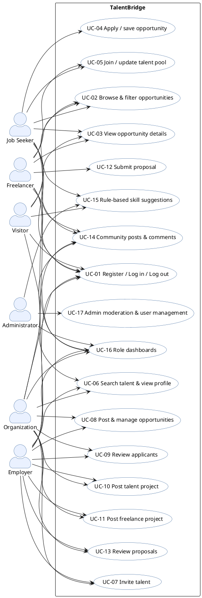

# Use Cases — TalentBridge

| Item | Value |
|---|---|
| Document version | 1.0 |
| Date | 2026-10-29 |
| Related requirements | `docs/requirements.md` |
| Diagram formats | Mermaid (overview) + PlantUML (exact UML use-case source) |

---

## 1. Actors

| Actor | Type | Description |
|---|---|---|
| Visitor | Primary, unauthenticated | Browses public content |
| Job seeker | Primary, authenticated | Applies for opportunities and joins the talent pool |
| Freelancer | Primary, authenticated | Submits proposals and joins the talent pool |
| Employer | Primary, authenticated | Posts opportunities, reviews applicants, invites talent, may act as a client |
| Organization | Primary, authenticated | Maintains an organization profile, posts projects/opportunities, invites talent |
| Administrator | Primary, authenticated, privileged | Manages users and content, moderates the community |
| Database | Supporting system | Persists all records and enforces uniqueness |
| Rule engine | Supporting system | Produces deterministic skill suggestions |
| Notification service | Supporting system | Writes in-app notifications and queues email for relevant events |

---

## 2. Use-case index

| ID | Use case | Primary actor(s) | Requirements |
|---|---|---|---|
| UC-01 | Register an account | Visitor | FR-38, FR-47–FR-50 |
| UC-02 | Log in | Registered user | FR-51, FR-54 |
| UC-03 | Log out | Any authenticated actor | FR-52 |
| UC-04 | Browse and filter opportunities | Visitor, talent | FR-07–FR-10 |
| UC-05 | View opportunity details | Visitor, talent | FR-11 |
| UC-06 | Apply for an opportunity | Job seeker, freelancer | FR-12–FR-14, FR-25 |
| UC-07 | Save an opportunity | Job seeker, freelancer | FR-15 |
| UC-08 | Join or update the talent pool | Job seeker, freelancer | FR-21, FR-22 |
| UC-09 | Search talent and view public profile | Visitor, organization-side | FR-18–FR-20 |
| UC-10 | Invite talent | Employer, organization, admin | FR-23, FR-24 |
| UC-11 | Post and manage an opportunity | Employer, organization, admin | FR-16 |
| UC-12 | Review applicants and update status | Employer, organization, admin | FR-17, FR-67 |
| UC-13 | Post a talent project | Employer, organization, admin | FR-25, FR-26 |
| UC-14 | Post a freelance project (client) | Employer, organization, admin | FR-31, FR-36 |
| UC-15 | Submit a proposal | Freelancer | FR-33–FR-35, FR-37 |
| UC-16 | Review proposals | Client (employer/organization), admin | FR-36, FR-37, FR-67 |
| UC-17 | Create a community post or comment | Any authenticated actor | FR-42–FR-46 |
| UC-18 | Moderate content and manage users | Administrator | FR-63–FR-65 |
| UC-19 | Get rule-based skill recommendations | Visitor, any authenticated actor | FR-27–FR-30 |
| UC-20 | View a role dashboard | Any authenticated actor | FR-58–FR-62, FR-66 |
| UC-21 | Message another member | Any authenticated actor | FR-73 |
| UC-22 | Send, accept or decline an offer | Employer, job seeker, freelancer | FR-74, FR-75 |

---

## 3. Detailed use-case descriptions

### UC-01 — Register an account

| Field | Detail |
|---|---|
| Primary actor | Visitor |
| Goal | Create a usable account with the correct role |
| Preconditions | Visitor is not logged in; email is not already registered |
| Trigger | Visitor submits the registration form |
| Postconditions | A `users` row exists with a hashed password; for employer/organization roles a placeholder `organizations` row exists; the user is logged in and sees their dashboard |
| Requirements | FR-38, FR-47–FR-50, FR-56 |

**Main flow**

1. Visitor opens the registration page (`/register`).
2. System displays name, email, password, confirm password, and account-type fields. Only the four public roles are offered.
3. Visitor enters valid data and selects a role.
4. Frontend performs basic checks (required fields, email shape, password length, matching passwords).
5. System validates again on the server: required fields, email format, email uniqueness, password length, password confirmation, role whitelist.
6. Django hashes the password with its configured password hashers.
7. System inserts the user inside a transaction.
8. For employer/organization roles, system inserts an organization owned by the new user.
9. System regenerates the session ID, stores the user ID and role in the session, and creates a CSRF token.
10. The React app navigates to the dashboard for the new user's role.

**Alternate flows**

- 5a. Invalid or missing field → the API returns HTTP 400 and the form re-displays field-level errors and safe values; do not insert.
- 5b. Email already exists → show "An account with this email already exists"; suggest login. Do not reveal other account details.
- 5c. Submitted role is `admin` or unknown → reject with HTTP 422; never create an administrator.
- 7a. Database error → roll back, log the technical error, show a friendly message.

**Business rules:** BR-06, BR-12; passwords never logged.

---

### UC-02 — Log in

| Field | Detail |
|---|---|
| Primary actor | Registered user |
| Goal | Start an authenticated session |
| Preconditions | Account exists and is `active` |
| Trigger | User submits the login form |
| Postconditions | Session ID regenerated; user ID, role, and CSRF token stored; user redirected to their dashboard |
| Requirements | FR-51, FR-54, FR-56 |

**Main flow**

1. User opens the login page (`/login`).
2. User enters email and password.
3. Server looks up the user by email using a prepared statement.
4. Server checks the account status and verifies the stored hash.
5. Django creates a fresh session and rotates the CSRF token.
6. Server redirects to the dashboard for the user's role.

**Alternate flows**

- 3a. Email not found or password incorrect → show the same generic message ("Email or password is incorrect") to avoid account enumeration.
- 4a. Account suspended → deny login with a neutral message; log the event.
- 4b. Too many recent failures from the same session/IP → delay or temporarily block attempts (FR-57, should-have).

**Postcondition failure:** no session identity is stored; the visitor remains unauthenticated.

---

### UC-03 — Log out

| Field | Detail |
|---|---|
| Primary actor | Any authenticated actor |
| Goal | End the session securely |
| Preconditions | Authenticated session exists |
| Trigger | User submits the logout form (POST) |
| Postconditions | Session data cleared, session cookie expired, session destroyed, redirect to home |
| Requirements | FR-52, FR-56 |

**Main flow**

1. User clicks "Log out", which submits a POST form containing the CSRF token.
2. Server verifies the CSRF token.
3. Django flushes the session and expires the session cookie.
4. The React app navigates to the home page.

**Alternate flows**

- 2a. Invalid/missing CSRF token → HTTP 403, session retained, no logout.
- 1a. A GET request to the logout endpoint → method not allowed; no logout occurs.

---

### UC-04 — Browse and filter opportunities

| Field | Detail |
|---|---|
| Primary actor | Visitor or talent |
| Goal | Find relevant open opportunities |
| Preconditions | None |
| Trigger | User opens `/opportunities` or changes a filter |
| Postconditions | A paginated, filtered result set is displayed; URL reflects filters so it can be shared |
| Requirements | FR-07–FR-10, FR-69, FR-71, FR-72 |

**Main flow**

1. User opens the listing page.
2. System reads optional filters: keyword, location, type, category, skill, SDG, deadline-before.
3. System validates filters against whitelists and maximum lengths.
4. System builds a prepared query with only `open`, non-expired opportunities, joins organization and skill data, applies filters, orders by deadline ascending, and paginates.
5. System renders cards with title, organization, location, type, skills, deadline, and "View details".
6. User changes a filter and submits; steps 2–5 repeat.

**Alternate flows**

- 3a. Invalid type/SDG/deadline → ignore the invalid value and show a non-blocking notice, or return HTTP 422 for the JSON endpoint.
- 5a. No results → show an empty state with a "Clear filters" link.
- 6a. Filter changes call `GET /api/opportunities/` and cards update without a full reload.

**Business rule:** only open opportunities whose deadline has not passed are publicly listed (BR-03).

---

### UC-05 — View opportunity details

| Field | Detail |
|---|---|
| Primary actor | Visitor or talent |
| Goal | Understand the opportunity before applying |
| Preconditions | Opportunity exists and is open (or the viewer owns it / is admin) |
| Trigger | User selects "View details" |
| Postconditions | Full details displayed; apply/save controls reflect authentication and eligibility |
| Requirements | FR-11, FR-20 |

**Main flow**

1. System validates the `id` parameter as a positive integer.
2. System loads the opportunity, organization, skills, and SDG.
3. If not found or not publicly visible → HTTP 404.
4. System displays all fields and the correct action state:
   - anonymous → "Log in to apply";
   - eligible talent → "Apply" and "Save";
   - already applied → "Application submitted" (no second form);
   - owner/admin → management links.
5. User may open the apply form (UC-06) or save (UC-07).

---

### UC-06 — Apply for an opportunity

| Field | Detail |
|---|---|
| Primary actor | Job seeker or freelancer |
| Goal | Submit an application |
| Preconditions | Authenticated; role is job seeker or freelancer; opportunity open and not expired |
| Trigger | User submits the application form |
| Postconditions | Exactly one `applications` row exists for this user and opportunity; owner receives a notification; applicant sees status |
| Requirements | FR-12–FR-14, FR-25, FR-56, FR-72 |

**Main flow**

1. User opens the apply form from the details page.
2. User writes a cover letter (20–3000 characters) and submits with a CSRF token.
3. Server verifies authentication, role, CSRF, input length, opportunity status, and deadline.
4. Server checks for an existing application.
5. Server inserts the application with status `submitted` inside a transaction and adds a notification for the opportunity owner.
6. Server redirects to the details page with a success message.

**Alternate flows**

- 3a. Not logged in → redirect to login with a safe return URL; after login, return to the details page.
- 3b. Wrong role (employer/organization/admin) → HTTP 403.
- 3c. Opportunity closed/expired → HTTP 409 with "This opportunity is no longer accepting applications".
- 4a. Already applied → HTTP 409 with a friendly message; no second insert.
- 4b. Race condition: two simultaneous submissions → the `UNIQUE(user_id, opportunity_id)` constraint rejects the second; system shows the same friendly message.
- 5a. Database failure → rollback, log, HTTP 500 message.

---

### UC-07 — Save an opportunity

| Field | Detail |
|---|---|
| Primary actor | Job seeker or freelancer |
| Goal | Keep an opportunity for later |
| Preconditions | Authenticated with a talent-side role; opportunity visible |
| Trigger | User selects "Save" / "Unsave" |
| Postconditions | A `saved_opportunities` row is created or removed; dashboard reflects the change |
| Requirements | FR-15, FR-56 |

**Main flow**

1. User submits a POST with the opportunity ID and CSRF token.
2. Server verifies role and CSRF.
3. Server toggles the saved state using `INSERT IGNORE` or `DELETE`.
4. The API returns the updated state and the page shows a confirmation message.

**Alternate flow:** invalid ID → 404; unauthenticated → redirect to login.

---

### UC-08 — Join or update the talent pool

| Field | Detail |
|---|---|
| Primary actor | Job seeker or freelancer |
| Goal | Publish a discoverable talent profile |
| Preconditions | Authenticated with a talent-side role |
| Trigger | User submits the talent profile form |
| Postconditions | `profiles` row created/updated; `user_skills` and `user_sdgs` synchronised; profile visible if marked public |
| Requirements | FR-21, FR-22, FR-56, FR-71, FR-72, NFR-10 |

**Main flow**

1. User opens the form; existing data is pre-filled when a profile exists.
2. User enters full name (account), phone, location, professional title, bio, education, experience, availability, portfolio URL, LinkedIn URL, skills, SDG interests, and public visibility.
3. Frontend validates required fields, URL shape, and list lengths.
4. Server validates all fields, checks that selected skills and SDGs exist, and normalises URLs.
5. Server writes the profile and replaces skill/SDG links inside a transaction.
6. Server redirects to the public profile preview with a success message.

**Alternate flows**

- 4a. Validation failure → re-display the form with errors, preserving safe values and selections.
- 4b. Invalid skill/SDG ID → reject the whole submission (no partial writes).
- 5a. Duplicate skill IDs → de-duplicate silently before insert.
- 5b. Database failure → rollback.

**Privacy:** email comes from the account and is never copied into public profile output; phone is stored but hidden publicly (BR-09).

---

### UC-09 — Search talent and view a public profile

| Field | Detail |
|---|---|
| Primary actor | Visitor or organization-side user |
| Goal | Find people by skill, SDG, availability, or location |
| Preconditions | None for public profiles |
| Trigger | User opens `/talent` or a profile link |
| Postconditions | Filtered cards or a public profile page with no private contact data |
| Requirements | FR-18–FR-20 |

**Main flow**

1. User opens the talent directory.
2. User enters a name keyword and/or selects skill, SDG, availability, and location.
3. System validates filters, queries only public profiles, joins skills and SDGs, paginates, and renders cards.
4. User opens a profile; system displays professional title, bio, education, experience, skills, SDGs, availability, portfolio/LinkedIn links, and an "Invite" action for authorized roles.
5. Anonymous users see "Log in to invite".

**Alternate flows**

- 3a. Profile is not public → 404 for visitors; owner/admin can preview.
- 4a. Invalid/unknown ID → 404.

---

### UC-10 — Invite talent

| Field | Detail |
|---|---|
| Primary actor | Employer, organization, or administrator |
| Goal | Invite a specific talent profile to a project or opportunity |
| Preconditions | Authenticated organization-side role; target profile is public |
| Trigger | User submits the invitation form |
| Postconditions | `invitations` row created; recipient receives an in-app notification; sender sees the invitation in their dashboard |
| Requirements | FR-23, FR-24, FR-56, FR-67 |

**Main flow**

1. Authorized user opens a talent profile and chooses "Invite talent".
2. System loads only the public profile fields plus the profile ID.
3. User selects organization (owned organization), related project/opportunity (owned records only), and writes a message.
4. User submits with CSRF token.
5. Server verifies role, CSRF, ownership of organization/project/opportunity, target profile existence, message length, and that sender ≠ recipient.
6. Server inserts the invitation and a notification for the recipient.
7. Server redirects to the invitation list with a success message.

**Alternate flows**

- 3a. User has no organization profile → prompt to complete the organization profile first.
- 5a. Project/opportunity is not owned by the sender → HTTP 403.
- 5b. Self-invitation → HTTP 422.
- 5c. Target profile is private → 404.
- 5d. Duplicate invitation for the same recipient and project within 24 hours → warn and prevent (application-level check).

---

### UC-11 — Post and manage an opportunity

| Field | Detail |
|---|---|
| Primary actor | Employer or organization |
| Goal | Publish an opportunity and manage its lifecycle |
| Preconditions | Authenticated organization-side role with an organization profile |
| Trigger | User submits the opportunity form |
| Postconditions | `opportunities` row owned by the user's organization; skills linked; visible publicly while open |
| Requirements | FR-16, BR-05, FR-56 |

**Main flow**

1. User opens the post-opportunity form (from dashboard/enterprise).
2. User enters title, description, responsibilities, requirements, location, type, category, deadline, remote flag, skills, and SDG.
3. Server validates ownership, required fields, enum values, deadline in the future, and skill/SDG existence.
4. Server inserts the opportunity and its skill links in a transaction.
5. Server redirects to the opportunity's management view.

**Alternate flows**

- 1a. Unauthorized role → HTTP 403.
- 3a. Deadline in the past → validation error.
- 5a. Edit/close: only the owning organization or admin may proceed; ownership is re-checked on every request.

---

### UC-12 — Review applicants and update status

| Field | Detail |
|---|---|
| Primary actor | Employer or organization |
| Goal | Move candidates through the pipeline |
| Preconditions | Authenticated owner of the opportunity |
| Trigger | Owner opens the applicants list or changes a status |
| Postconditions | Application status updated; applicant notified |
| Requirements | FR-17, FR-67 |

**Main flow**

1. Owner opens the applicants page for one of their opportunities.
2. System verifies ownership and loads applicants with applicant name, professional title, skills, cover letter, and current status.
3. Owner selects a new status (reviewing, shortlisted, rejected, hired) and submits with CSRF.
4. Server verifies ownership, validates the status whitelist, updates the row, and notifies the applicant.
5. Server redirects back with a success message.

**Alternate flows**

- 2a. Opportunity belongs to another organization → HTTP 403, not 404, to make the denial explicit; no data returned.
- 3a. Invalid status → 422.

---

### UC-13 — Post a talent project

| Field | Detail |
|---|---|
| Primary actor | Employer or organization |
| Goal | Recruit multiple people for a time-bound project |
| Preconditions | Authenticated organization-side role |
| Trigger | User submits the talent project form |
| Postconditions | `talent_projects` row with skills, deadline, and capacity; visible to talent |
| Requirements | FR-25, FR-26 |

**Main flow**

1. User enters organization, title, description, required skills, SDG, duration, location, remote/on-site, number of talent required, and deadline.
2. Server verifies role, organization ownership, field validity, and deadline.
3. Server inserts the project and skill links in a transaction.
4. Server redirects to the organization dashboard.

**Alternate flow:** only the owning organization/admin may edit, close, or delete; all other attempts return 403.

---

### UC-14 — Post a freelance project (client)

| Field | Detail |
|---|---|
| Primary actor | Employer or organization acting as a client |
| Goal | Publish a paid project and receive proposals |
| Preconditions | Authenticated organization-side role |
| Trigger | Client submits the freelance project form |
| Postconditions | `freelance_projects` row owned by the client with budget, deadline, duration, and skills |
| Requirements | FR-31, FR-36, BR-05 |

**Main flow**

1. Client enters title, description, skills, budget in NPR, deadline, duration, and optional organization.
2. Server validates role, ownership, budget > 0, deadline in the future, and skill existence.
3. Server inserts the project and skill links in a transaction.
4. Server redirects to the project management view.

**Alternate flow:** only the owning client/admin may edit, close, cancel, or view proposals.

---

### UC-15 — Submit a proposal

| Field | Detail |
|---|---|
| Primary actor | Freelancer |
| Goal | Bid for a freelance project |
| Preconditions | Authenticated freelancer; project open and not expired; no existing proposal |
| Trigger | User submits the proposal form |
| Postconditions | Exactly one proposal row; client notified; freelancer sees it in the dashboard |
| Requirements | FR-33–FR-35, FR-37, FR-56 |

**Main flow**

1. Freelancer opens the project details page and the proposal form.
2. Freelancer enters bid amount (NPR), estimated delivery days, cover letter, relevant skills, and portfolio URL.
3. Server verifies role, CSRF, numeric ranges, project status/deadline, and existing proposal.
4. Server inserts the proposal with status `submitted` and notifies the client.
5. Server redirects to the freelancer dashboard.

**Alternate flows**

- 2a. Duplicate proposal → 409 with a clear message; unique constraint is the final guard.
- 3a. Project closed/expired → 409.
- 3b. Non-freelancer → 403.
- 4a. Database failure → rollback.

---

### UC-16 — Review proposals

| Field | Detail |
|---|---|
| Primary actor | Client or administrator |
| Goal | Compare bids and select a freelancer |
| Preconditions | Authenticated owner of the project or admin |
| Trigger | Client opens the proposals list |
| Postconditions | Proposals visible only to the owner; status may be updated; freelancer notified |
| Requirements | FR-36, FR-37, FR-67 |

**Main flow**

1. Client opens their project's proposal list.
2. System verifies ownership before querying.
3. System lists bid amount, delivery days, cover letter, skills, portfolio, freelancer public name/title, date, and status.
4. Client shortlists, accepts, or rejects a proposal with a CSRF-protected action.
5. System updates the status, notifies the freelancer, and marks the project `in_progress` when a proposal is accepted.

**Alternate flows**

- 2a. Another client's project → 403; no proposal data is loaded.
- 5a. Accepting a second proposal → require explicit confirmation and keep a single accepted proposal per project (application-level rule; documented).
- 5b. Cascading status change fails → transaction rollback.

---

### UC-17 — Create a community post or comment

| Field | Detail |
|---|---|
| Primary actor | Any authenticated actor |
| Goal | Share a discussion, event, resource, or comment |
| Preconditions | Authenticated and active account |
| Trigger | User submits the post or comment form |
| Postconditions | Published post/comment visible on the community page |
| Requirements | FR-42–FR-46, FR-71 |

**Main flow**

1. User opens the community page and chooses "New post" or a comment box.
2. User selects a type, enters a title/body, and optionally an event date/location or resource URL.
3. Server verifies authentication, CSRF, required fields, length limits, type whitelist, and announcement restriction.
4. Server inserts the record and redirects (PRG) with a success message.
5. Output is escaped when rendered.

**Alternate flows**

- 2a. Non-admin selects "announcement" → 403.
- 3a. Invalid URL → validation error.
- 4a. Author edits/deletes own post; admin may hide any post/comment.

---

### UC-18 — Moderate content and manage users

| Field | Detail |
|---|---|
| Primary actor | Administrator |
| Goal | Keep the platform safe and accurate |
| Preconditions | Authenticated admin; 2FA is a future enhancement |
| Trigger | Admin opens an admin management page |
| Postconditions | User status, roles, content visibility, or records are updated; actions are timestamped |
| Requirements | FR-63–FR-65, BR-11, BR-12 |

**Main flow**

1. Admin opens `/dashboard/admin` and reviews platform statistics.
2. Admin searches users and suspends/reactivates an account or changes a non-admin role.
3. Admin hides/unhides community posts and comments, closes opportunities, verifies organizations, or removes invalid projects.
4. Every state-changing action is POST + CSRF and is validated server-side.
5. The affected user may receive a notification.

**Alternate flows**

- 3a. Admin attempts to suspend their own account or demote the last admin → rejected with an explanation.
- 4a. Invalid ID/target → 404 or 422.
- 5a. Suspended user's next authenticated request destroys their session (BR-11).

---

### UC-19 — Get rule-based skill recommendations

| Field | Detail |
|---|---|
| Primary actor | Visitor or authenticated user |
| Goal | Find open opportunities that match chosen skills, plus related skills and SDGs |
| Preconditions | None |
| Trigger | User selects up to five skills on `/skills` and chooses "Show my matches" |
| Postconditions | Ranked open opportunities, complementary skills, and related SDGs, all labelled as rule-based |
| Requirements | FR-27–FR-30 |

**Main flow**

1. User browses or searches the catalogue and selects up to five skills.
2. The page calls `GET /api/catalog/recommendations/` with the selected skill IDs.
3. The server validates ids, ignores duplicates, and rejects missing, invalid, unknown, or over-limit selections with a 422 JSON error (the HTML page shows a warning and continues with the first five valid ids).
4. `core/recommender.py` scores each open, unexpired opportunity by one point per matching skill, then orders by points, nearest deadline, and id.
5. The response adds complementary skills (co-occurrence counts), related SDGs, the exact rules used, and the label "Rule-based suggestions".
6. The page lists at most six opportunities, eight complementary skills, and four SDGs, with a visible "not AI or machine learning" disclaimer.

**Alternate flow:** the API request fails → the page shows an error state and keeps the selected skills.

---

### UC-20 — View a role dashboard

| Field | Detail |
|---|---|
| Primary actor | Any authenticated actor |
| Goal | See the information and actions relevant to their role |
| Preconditions | Authenticated and active |
| Trigger | User logs in or opens their dashboard route |
| Postconditions | Dashboard scoped to the user's own records |
| Requirements | FR-58–FR-62, FR-66 |

**Main flow**

1. The dashboard route requires login and reads the role from the session (not from a URL parameter).
2. System redirects or includes the matching dashboard:
   - job seeker → applications, saved, recommendations;
   - freelancer → proposals, active projects;
   - employer/organization → owned opportunities, applicants, projects, invitations;
   - admin → admin statistics and management.
3. Every query uses the authenticated user/organization ID from the session.
4. UI hides actions the role cannot perform; the server enforces the same rules on every request.

**Alternate flow:** a user manually requests another role's dashboard → the guard checks the session role and returns 403; no data is loaded.

---

### UC-21 — Message another member

| Field | Detail |
|---|---|
| Primary actor | Any authenticated actor |
| Goal | Exchange a private message with another member |
| Preconditions | Both accounts exist and are active; the sender is authenticated |
| Trigger | Sender uses a "Message" button on an opportunity, profile, applicant card or invitation |
| Postconditions | A `Conversation` and `Message` row exist; recipient has an in-app notification and an email |
| Requirements | FR-73 |

**Main flow**

1. Sender opens the message dialog and writes a message.
2. `POST /api/messaging/` resolves or creates the canonical one-to-one conversation.
3. The message is stored with the sender and creation time.
4. `notify()` creates an in-app notification for the recipient.
5. `queue_email()` renders `new_message` and records/attempts delivery.
6. Both inboxes show the thread; the recipient's header unread badge increments.

**Alternate flows**

- 2a. Sender targets themselves → rejected; no conversation is created.
- 5a. Mail delivery fails → the outbox row is marked `failed`; the message and notification remain intact.

---

### UC-22 — Send, accept or decline an offer

| Field | Detail |
|---|---|
| Primary actor | Employer sends; job seeker or freelancer responds |
| Goal | Move an application to an agreed outcome visible to both sides |
| Preconditions | An application exists for an opportunity owned by the sender |
| Trigger | Employer moves an application to "Offer sent", or candidate opens the offer on their dashboard |
| Postconditions | Application status is `offered`, `accepted` or `declined`; both sides have notifications and the employer has an email |
| Requirements | FR-17, FR-67, FR-74, FR-75 |

**Main flow**

1. Employer moves an application to `offered` with `PATCH /api/opportunities/applications/:id/status/`.
2. The candidate sees the offer card with Accept and Decline buttons and receives a notification and email.
3. The candidate posts `POST /api/opportunities/applications/:id/respond/` with `action` set to `accept` or `decline`.
4. The status becomes `accepted` or `declined`.
5. The employer receives a notification and email; offer counts on both dashboards update.

**Alternate flows**

- 1a. Employer does not own the opportunity → HTTP 403.
- 3a. Application is not in `offered` state → rejected with HTTP 400.
- 5a. Mail delivery fails → the outbox row is marked `failed`; in-app state is unchanged.

---

## 4. Use-case diagram

### 4.1 Mermaid overview

Mermaid has no native UML use-case shapes, so this is a faithful overview using stadium nodes for use cases and labelled subgraphs for the system boundary. The PlantUML source in section 4.2 is the exact UML version for the report.

Rendered preview: `docs/diagrams/use-case.svg` / `.png`. Standalone Mermaid source: `docs/diagrams/use-case.mmd`.

```mermaid
flowchart LR
    classDef actor fill:#eaf1ff,stroke:#164a8a,stroke-width:1.5px,color:#102a43    classDef usecase fill:#ffffff,stroke:#164a8a,stroke-width:1px,color:#102a43
    classDef system fill:#f7f9fc,stroke:#164a8a,stroke-width:1px

    V["Visitor"]:::actor
    JS["Job Seeker"]:::actor
    FL["Freelancer"]:::actor
    EMP["Employer"]:::actor
    ORG["Organization"]:::actor
    ADM["Administrator"]:::actor

    subgraph SYS["TalentBridge"]
        UC01(["Register / Log in / Log out"]):::usecase
        UC02(["Browse & filter opportunities"]):::usecase
        UC03(["View opportunity details"]):::usecase
        UC04(["Apply / save opportunity"]):::usecase
        UC05(["Join / update talent pool"]):::usecase
        UC06(["Search talent & view profile"]):::usecase
        UC07(["Invite talent"]):::usecase
        UC08(["Post & manage opportunities"]):::usecase
        UC09(["Review applicants"]):::usecase
        UC10(["Post talent project"]):::usecase
        UC11(["Post freelance project"]):::usecase
        UC12(["Submit proposal"]):::usecase
        UC13(["Review proposals"]):::usecase
        UC14(["Community posts & comments"]):::usecase
        UC15(["Rule-based skill suggestions"]):::usecase
        UC16(["Role dashboards"]):::usecase
        UC17(["Admin moderation & user management"]):::usecase
    end

    V --> UC01
    V --> UC02
    V --> UC03
    V --> UC06
    V --> UC15
    JS --> UC01
    JS --> UC02
    JS --> UC03
    JS --> UC04
    JS --> UC05
    JS --> UC14
    JS --> UC15
    JS --> UC16
    FL --> UC01
    FL --> UC02
    FL --> UC03
    FL --> UC05
    FL --> UC12
    FL --> UC14
    FL --> UC16
    EMP --> UC01
    EMP --> UC06
    EMP --> UC07
    EMP --> UC08
    EMP --> UC09
    EMP --> UC10
    EMP --> UC11
    EMP --> UC13
    EMP --> UC16
    ORG --> UC01
    ORG --> UC06
    ORG --> UC07
    ORG --> UC08
    ORG --> UC09
    ORG --> UC10
    ORG --> UC11
    ORG --> UC13
    ORG --> UC16
    ADM --> UC15
    ADM --> UC16
    ADM --> UC17
```

### 4.2 PlantUML source (exact UML)

Render at <https://www.plantuml.com/plantuml/uml/> or with the PlantUML extension in VS Code. Save as `docs/diagrams/use-case.puml` if you want a standalone file.



---

## 5. Traceability matrix

| Requirement group | Covered by |
|---|---|
| FR-01–FR-06 (public pages) | UC-02, UC-03, UC-06, UC-14, UC-19; tested in Stage 7 |
| FR-07–FR-17 (opportunities) | UC-02, UC-03, UC-04, UC-06, UC-08, UC-09, UC-11, UC-12 |
| FR-18–FR-26 (talent) | UC-05, UC-07, UC-08, UC-09, UC-10, UC-13 |
| FR-27–FR-30 (skills) | UC-15, UC-19 |
| FR-31–FR-37 (freelance) | UC-11, UC-12, UC-13 |
| FR-38–FR-41 (enterprise) | UC-01, UC-08, UC-14 |
| FR-42–FR-46 (community) | UC-14, UC-17 |
| FR-47–FR-57 (auth) | UC-01, UC-02, UC-03, UC-20 |
| FR-58–FR-67 (dashboards/admin) | UC-09, UC-10, UC-12, UC-16, UC-17, UC-18, UC-20 |
| FR-68–FR-72 (integration) | All use cases; enforced by the API contract |
| FR-73–FR-75 (messaging and offers) | UC-21, UC-22 |

---

## 6. Notes on diagram accuracy

- The Mermaid diagram is an **overview**, not a formal UML use-case diagram. It uses stadium nodes for use cases and subgraphs for the system boundary.
- The PlantUML source produces a standard UML use-case diagram with actors, use cases, and a system boundary.
- Association lines mean "actor participates in use case". `«include»`/`«extend»` relationships are deliberately omitted to keep the diagram readable; they are described in the detailed flows instead.
- Notification writes and database access are supporting behaviours inside use cases, not separate primary use cases.
